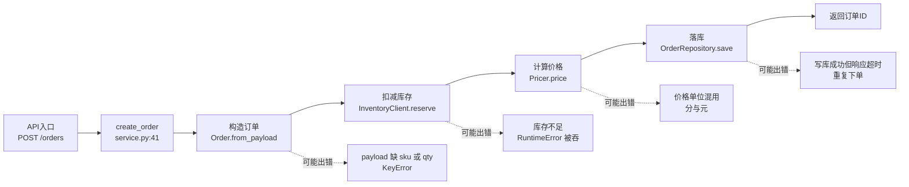

# 最小可运行示例：订单服务深读文档

演示从一句用户请求走到一份完整模块文档的全过程。示例项目是虚构的，用来展示工作流与输出格式。

示例中直接写出具体 MCP 工具名，是为了让流程具体可感；主文档 `SKILL.md` 用抽象措辞，是为了不绑定具体 server，工具名统一由 `mcp-selection.md` 承载。

**用户说**："帮我分析这个订单服务项目，出一份给新同事看的深读文档，重点讲清楚数据怎么流、哪里容易出错。"

## 第 1 步，触发与前置检查

命中"分析这个项目""讲清楚数据流""哪里容易出错"，加载 skill。读一遍可用 MCP 工具，然后只问缺失的信息：

- 目标项目路径：`~/work/order-service`（用户已给，不问）
- 输出位置：`docs/deep-dive/`
- 受众：新人
- 业务规则与已知故障：用户答"没有额外文档"

四项齐了，直接开工。

## 第 2 步，侦察

```text
analyze_project(project_path="~/work/order-service")
analyze_module_structure(file_path="order_service/")
query_codebase(query="order creation entry point", max_results=20)
```

得到模块清单：`api`（核心链路）、`service`（核心链路）、`repository`（公共设施）、`utils`（边缘）。共 4 个模块，未超过 5 个，不需要用户确认优先级，也不需要并行。取 `service` 优先。

## 第 3 步，取事实

```text
get_symbol_signature(symbol_name="order_service.service.create_order")
get_symbol_dependencies(symbol_name="order_service.service.create_order")
trace_dataflow(source="payload", file="order_service/api/routes.py", direction="forward", max_depth=5)
trace_effects(source="OrderService.create", direction="forward")
```

`get_symbol_dependencies` 只报了 `save`、`get` 两个简单名的边——通用名误报，回源码核对后确认真实调用是 `InventoryClient.reserve()` 与 `OrderRepository.save()`。

## 第 4 步，读原文

读 `order_service/api/routes.py:24-58`、`order_service/service.py:31-96`、`order_service/repository.py:12-40`，核对签名、错误处理与事务边界。

## 第 5 步，成文

按 `module-template.md` 产出 `docs/deep-dive/service.md`，四章齐全。文档内容如下。

````markdown
# OrderService 模块深度剖析

> 路径：`order_service/service.py`
> 承重等级：核心链路
> 输入符号：`OrderService.create_order`、`OrderService.cancel_order`
> 证据账本：本次模块 4 次 MCP 调用清单（见本模块工作记录）。

## 第一章 模块职责与原理

**职责**：把一次下单意图翻译成库存、价格、订单三方的一致变更。

**边界**：负责编排与校验；不负责库存判定规则本身，不负责定价公式，不负责持久化实现。

**原理**：编排式服务，无状态，靠"先远程扣减、后本地落库"的固定顺序保证库存不会超卖到负库存。代价是两步之间没有事务保护，进程中断会留下已扣减未落库的悬挂记录，由对账任务补偿。

**对外契约**：`create_order(payload: dict) -> str`，成功返回订单 ID，库存不足时抛出异常。`cancel_order(order_id: str) -> None`，幂等。

## 第二章 逐段代码剖析

### 创建订单主流程

**源码位置**：`order_service/service.py:41-51`

**原理说明**：先在内存里构造订单对象，再连续调用库存扣减与落库。两个副作用分属不同系统，中间没有事务保护，靠异常向上抛回滚。

**优化建议表格**：

| 维度 | 当前写法 | 建议写法 | 理由 |
|------|---------|---------|------|
| 可读性 | 扣库存、算价、落库三段平铺在同一函数 | 抽 `_reserve`、`_price`、`_persist` 三个私有方法 | 读者一眼看到主流程骨架，细节按需下钻 |
| 性能 | 库存扣减与落库串行 | 保持现状 | 两者有数据依赖，落库需要扣减结果，并行会引入一致性问题 |
| 可维护性 | 扣减失败直接 `raise`，调用方需感知底层异常 | 引入领域异常 `InsufficientStockError` | 上层不必依赖库存客户端实现，换实现时调用方不动 |

**示例代码对比**：

**源码（优化前）** `order_service/service.py:41-51`

```python
def create_order(self, payload: dict) -> str:
    order = Order.from_payload(payload)
    if not self.inventory.reserve(order.sku, order.qty):
        raise RuntimeError("inventory reserve failed")
    order.total = self.pricer.price(order)
    self.repo.save(order)
    return order.id
```

**优化后**

```python
class InsufficientStockError(DomainError):
    """库存不足，业务可预期失败。"""


def create_order(self, payload: dict) -> str:
    order = Order.from_payload(payload)
    self._reserve(order)
    order.total = self.pricer.price(order)
    self._persist(order)
    return order.id

def _reserve(self, order: Order) -> None:
    if not self.inventory.reserve(order.sku, order.qty):
        raise InsufficientStockError(sku=order.sku, requested=order.qty)

def _persist(self, order: Order) -> None:
    with self.repo.transaction():
        self.repo.save(order)
```

前置条件：`DomainError` 与 `OrderRepository.transaction()` 需要在 `order_service/errors.py`、`order_service/repository.py` 中补上。

**为什么不建议改**：库存扣减与落库之间的窗口保持无锁。改成分布式事务或全局锁后，每次下单多一轮协调往返，下单链路 p99 会明显抬升，而当前业务的超卖由对账任务兜底，收益不覆盖成本。将来若有秒杀类活动要求强一致，重新评估。

## 第三章 数据流向图



实线依据：`trace_dataflow(payload, forward, depth=5)` 返回的 6 条边，逐条已回源码核对。

**易错点标注**

| 位置 | 字段/条件 | 出错形态 | 触发条件 | 后果 | 建议 |
|------|----------|---------|---------|------|------|
| `service.py:44` | `payload["qty"]` | 缺少字段直接 `KeyError` | 上游传不完整 payload | 500 而非 400 | 入口做 schema 校验 |
| `service.py:45` | `reserve()` 返回值 | 失败抛 `RuntimeError` | 库存不足 | 上层可能当系统错误重试 | 换领域异常 |
| `service.py:47` | `total` | 分与元混用 | 上游传元、定价算分 | 金额差 100 倍 | 统一用最小货币单位并加断言 |
| `service.py:48` | `save()` 与响应 | 写库成功、响应超时 | 网络抖动 | 客户端重试造成重复订单 | 幂等键 |

## 第四章 业务优化建议汇总

| 优先级 | 问题 | 位置 | 建议 | 预期收益 | 成本 | 结论 |
|--------|------|------|------|---------|------|------|
| P0 | 金额单位混用 | `service.py:47` | 统一最小货币单位并加断言 | 消除 100 倍金额错误 | 低 | 建议改 |
| P0 | 重复下单 | `service.py:48` | 引入幂等键 | 消除重复订单与对账成本 | 中 | 建议改 |
| P1 | 底层异常外泄 | `service.py:45` | 引入领域异常 | 上层错误处理与实现解耦 | 低 | 建议改 |
| P1 | 主流程过长 | `service.py:41-51` | 抽三段私有方法 | 新人上手更快 | 低 | 建议改 |
| P2 | 扣减与落库加锁 | `service.py:45-48` | 保持现状 | — | 高 | 不建议改：p99 抬升超过超卖收益 |

**不建议改清单**：扣减与落库之间保持无锁。当前超卖由对账任务兜底，改成全局锁或分布式事务会让每次下单多一轮协调往返，p99 抬升的代价超过超卖损失。重新评估的触发条件：出现秒杀类活动，或对账任务的补偿量超过日均订单的千分之一。
````

## 第 6 步，校验

按 `output-checklist.md` 逐项过一遍：

- 抽查 4 处行号，全部与原文一致。
- Mermaid 渲染通过，虚线对应的 4 条易错点在表里都有条目。
- 七项清单逐条勾选，无缺项。
- 回填工具账本：第四章 5 条建议中 4 条能追到 `trace_dataflow` 或 `trace_effects` 的返回；"金额单位混用"只有源码依据，标为**推测**。
- 挂起项：`Pricer.price` 内部是否已按分计算——补一次 `get_symbol_signature(symbol_name="order_service.pricer.Pricer.price")` 即可确认。

## 第 7 步，收尾

按 `api`、`repository`、`utils` 的优先级继续循环。4 个模块全部做完后生成 `docs/deep-dive/INDEX.md`，含模块清单、目录、全局数据流向图与跨模块 P0 汇总，并把挂起项交给用户。
