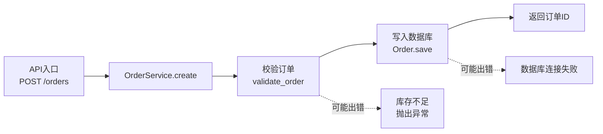

# 模块文档模板

每个模块产出一份 Markdown 文档，按下面的结构与格式写。四章齐全视为完成，缺章回阶段二补齐。占位符 `<...>` 与示例行里的 `...` 都换成实例内容。默认以 Python 举例，格式本身语言无关。

````markdown
# <模块名> 深度剖析

> 路径：`<相对路径>`
> 承重等级：核心链路 / 公共设施 / 边缘
> 输入符号：<核心符号列表>
> 证据账本：<本次模块的 MCP 调用清单>

## 第一章 模块职责与原理

**职责**：一句话说清这个模块替系统承担什么。

**边界**：负责什么、明确不负责什么。

**原理**：它依赖的核心机制（状态机、缓存策略、事务边界、并发模型）。讲清"为什么这样设计"，而不是复述代码。

**对外契约**：核心符号签名与语义，逐个列出。

## 第二章 逐段代码剖析

按逻辑段落切分，一段一个 `### <小节标题>`，用下面的六件套。段落划分依据是"做成一件事"，不是"一个函数一段"。

### <小节标题>

**源码位置**：`path/to/file.py:120-168`

**原理说明**：这段代码做什么、为什么这样写。点出它在数据流里的角色。

**优化建议表格**：

| 维度 | 当前写法 | 建议写法 | 理由 |
|------|---------|---------|------|
| 可读性 | ... | ... | ... |
| 性能 | ... | ... | ... |
| 可维护性 | ... | ... | ... |

每一维都要给出判断：写"保持现状"要说清它好在哪，写"不适用"要说清这一维在此段为什么不成立；空着或只写"无"视为未完成。

**示例代码对比**：

**源码（优化前）** `path/to/file.py:120-140`

```python
# 原始代码
```

**优化后**

```python
# 建议代码
```

并排对照表（改动点多于 3 处时补一张）：

| 改动点 | 源码 | 优化后 | 影响面 |
|--------|------|--------|--------|
| ... | ... | ... | ... |

"优化后"代码必须可运行。依赖新包或新配置时，在对比下方写明前置条件。

**为什么不建议改**：当本节结论是保持现状时写，给出具体技术理由——瓶颈不在这一层、改动引入的复杂度超过收益、会破坏既有契约、与团队约定冲突、缺少回归测试网。写"没必要""问题不大"不算完成。

## 第三章 数据流向图



图上每个节点对应一个已确认的符号或外部边界，每条实线对应一次调用或一次数据传递（标注 `file:line`），虚线只用于"可能出错"。

**易错点标注**

| 位置 | 字段/条件 | 出错形态 | 触发条件 | 后果 | 建议 |
|------|----------|---------|---------|------|------|
| `service.py:88`（`validate_order`） | `stock_qty` | 负数未拦截 | 上游传入已扣减库存 | 超卖 | 加不变量断言 |
| `<位置>` | `<字段或条件>` | `<出错形态>` | `<触发条件>` | `<后果>` | `<建议>` |

易错点覆盖三类：字段级（类型、空值、单位、精度）、条件级（边界、并发窗口、时区、排序）、异常分支级（被吞掉的异常、默认返回值、重试语义）。每条必须落到具体字段、具体条件或具体异常分支，"注意异常处理"这类写法不算完成。

## 第四章 业务优化建议汇总

| 优先级 | 问题 | 位置 | 建议 | 预期收益 | 成本 | 结论 |
|--------|------|------|------|---------|------|------|
| P0 | ... | `file.py:88` | ... | ... | ... | 建议改 |
| P1 | ... | `file.py:140` | ... | ... | ... | 建议改 |
| P2 | ... | `file.py:200` | ... | ... | ... | 不建议改：瓶颈在 DB 层 |

每行填齐七列。

优先级判定：P0 正确性或数据损失风险；P1 可维护性与明显性能损耗；P2 风格与微优化。P0 只给正确性、数据一致性与安全问题，不给风格问题。

**不建议改清单**：把结论=不建议改的条目集中重列一遍，每条给出技术理由与将来值得重新评估的触发条件。
````

## Mermaid 写法要求

- 节点标签里的换行用 `\n`，且只出现在方括号内的标签里。
- 节点文本里出现 `[`、`]`、`(`、`)`、`|` 时，用引号把标签包住。
- 虚线（`-.->`）只用于"可能出错"的分支，并在箭头标签里写错误形态。
- 实线旁标注 `file:line`，让读者能跳到源码。
- 交付前能渲染就渲染一遍（mermaid-cli 或浏览器预览）确认语法通过；没有渲染条件时，逐条把节点与边对照源码核验。渲染通过只是语法判据，节点与边对得上源码才是完成标准。
